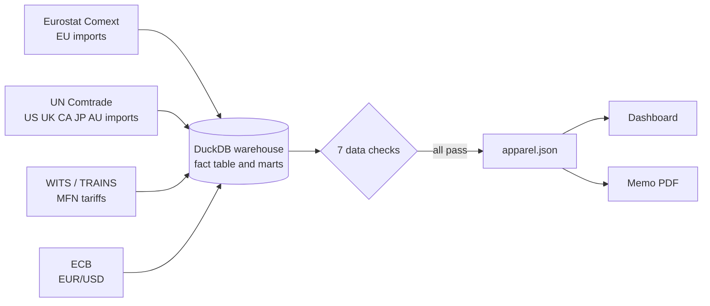

# Bangladesh apparel after LDC graduation

**The question.** Bangladesh leaves the UN's least developed country list on 24 November 2029, after the UN
General Assembly granted a three-year deferral on 29 October 2026. With the EU's three-year transition, duty-free
access to Europe under Everything But Arms runs to about November 2032. After that, unless GSP+ or a trade deal
replaces it, Bangladeshi garments pay the EU's 12% duty while Vietnam and India pay nothing. So where should
Bangladeshi apparel compete next: which products, which markets?

**The answer.** Defend knitwear in the EU by making it GSP+ ready, take woven growth to the US and UK, and build
man-made-fibre capacity for the categories China is leaving. The full argument is in the
[four-page memo](memo/strategy_memo.pdf); the evidence is in the [live dashboard](https://zubayerojhor.github.io/bd-apparel-after-ldc/).

All data is real and public. Nothing is simulated.

## What the data says

| | |
|---|---|
| Bangladesh's share of EU apparel imports | 16.2% in 2015, 22.1% in 2022, 20.4% in 2025 as China came back to 32.6% |
| Bangladesh's share of US apparel imports | 6.1% in 2015, 10.0% in 2025; China fell from 36.2% to 14.6%, Vietnam rose to 20.8% |
| EU imports from Bangladesh, Jan to Sep 2026 | -11.9% on the same months of 2025 (in euros); China +4.5%, Vietnam +4.3%, all suppliers -2.5% |
| Bangladesh's US price per item | 59 to 84% of Vietnam's, depending on the product group (2025) |
| Duty if EU access is lost | EUR 2.3bn on 2025's EUR 19.5bn of sales; EUR 0.8bn under GSP+ |
| Sales at risk if access is lost | EUR 3.9bn to 7.0bn (20 to 36%), against duty-free Vietnam and India |

## How it is built



- **Scope:** six import markets (EU, US, UK, Canada, Japan, Australia), five exporters (Bangladesh, Vietnam,
  Cambodia, India, China), HS chapters 61 and 62 at four digits grouped into ten product groups, 2015 to 2025,
  plus EU monthly data to September 2026.
- **Marts:** market share, product-group share, unit values (USD per item, EUR per kg), EU tariff exposure, and
  three scenarios for EU access after 2032.
- **Checks:** nothing is exported unless all seven pass.

| Check | Why |
|---|---|
| Bangladesh has data in every market and year | A gap would look like a collapse in a chart |
| World imports cover the five exporters, line by line | Catches partner-code and unit mistakes |
| EU product detail and 12 months tie to Eurostat's chapter totals | Two datasets, one truth (within 0.5%) |
| No negative values; shares between 0 and 1 | Basic sanity |
| Unit values in a plausible range | A unit mix-up cannot reach a chart |
| An MFN rate for all 34 product lines in both schedules | No silent zero duties |
| EU trade without product detail is sized | 4.5% of 2025 EU imports, mostly EUR 4bn from China |

## Assumptions you may disagree with

- **GSP+ rules of origin.** Knitwear uses 80 to 90% local fabric and woven 35 to 40%, so 15% of knit value and
  62.5% of woven value would fail two-stage origin and pay MFN.
- **Volume effect.** Lost share = 1 - (1 + duty)^-σ against duty-free competitors, with σ from 2 to 4. A planning
  range, not a forecast.
- **Standard GSP** gives apparel no relief, because Bangladesh's share of EU GSP apparel imports is far above
  the graduation threshold.
- **2025 is the base year** for duty and risk; growth to 2032 is ignored.
- **Unit values** mix price and product: a lower value can mean a cheaper price or a simpler garment.

## Run it

```bash
pip install -e ".[dev]"
python -m apparel all          # fetch (cached in data/raw), build, check, export dashboard/data/apparel.json
pytest -q
python scripts/screenshots.py  # every dashboard tab, fails on console errors
python scripts/make_memo.py    # memo/strategy_memo.pdf
```

The first fetch takes about 20 minutes because the UN Comtrade public API is rate limited; after that every
call is read from `data/raw`. Raw downloads are not committed; `dashboard/data/apparel.json` is.

## Sources

- Trade: [Eurostat Comext DS-045409](https://ec.europa.eu/eurostat/comext/newxtweb/), [UN Comtrade](https://comtradeplus.un.org/), [WITS / UNCTAD TRAINS](https://wits.worldbank.org/), [ECB exchange rates via Eurostat](https://ec.europa.eu/eurostat/databrowser/view/ert_bil_eur_a/default/table).
- LDC deferral to 24 Nov 2029: [Prothom Alo](https://en.prothomalo.com/bangladesh/addcsizr3s), [The Business Standard](https://www.tbsnews.net/bangladesh/bangladesh-gets-3-more-years-ldc-graduation-1587421). EBA to 2032: [Modaes](https://www.modaes.com/global/markets/bangladesh-postpones-its-exit-from-the-group-of-poor-countries-and-secures-its-trade-advantage-in-europe).
- EU GSP from 2027: [EU Access2Markets](https://trade.ec.europa.eu/access-to-markets/en/news/eus-renewed-gsp-scheme-key-updates-2027); safeguard and origin: [The Daily Star](https://www.thedailystar.net/business/column/news/eu-gsp-rules-and-bangladeshs-rmg-4218431); twin-track approach: [The Daily Star](https://www.thedailystar.net/business/economy/news/govt-takes-twin-track-approach-retain-eu-duty-free-access-4210686).
- Competitors: EVFTA phase-out ([Apparel Resources](https://apparelresources.com/business-news/trade/tariff-lines-to-be-eliminated-for-vietnam-under-evfta/)); EU-India FTA ([Business Today](https://www.businesstoday.in/latest/economy/story/india-eu-fta-textiles-leather-labour-intensive-exports-boost-for-india-machinery-autos-win-for-eu-513100-2026-01-27)); Cambodia's partial EBA withdrawal ([The Diplomat](https://manage.thediplomat.com/2020/02/eu-partially-withdraws-cambodia-trade-deal-amid-rights-concerns)).
- UK after graduation: [The Daily Star](https://www.thedailystar.net/business/news/uk-market-remain-open-bangladesh-post-ldc-era-british-high-commission-4252741), [RAPID policy brief, Feb 2026](https://www.rapidbd.org/wp-content/uploads/2026/02/RAPID-Policy-Brief_-February-2026_UK-DCTS-Rules-of-Origin-Changes-and-Implications-for-Bangladeshs-Post-LDC-Apparel-Competitiveness-1.pdf).
- US: Section 301 tariff of 10% on Bangladesh from 24 Jul 2026 ([G-III Apparel 10-Q, SEC](https://www.sec.gov/Archives/edgar/data/0000821002/000110465926105950/giii-20260731x10q.htm)); IEEPA ruling ([Learning Resources v. Trump](https://en.wikipedia.org/wiki/Learning_Resources,_Inc._v._Trump)).
- Bangladesh: local fabric shares ([The Financial Express](https://thefinancialexpress.com.bd/trade/share-of-woven-garments-in-bangladesh-exports-decreases-for-lax-backward-linkage-1646447612)); FY26 exports ([The Financial Express](https://thefinancialexpress.com.bd/home/eu-share-erodes-as-bangladesh-rmg-exports-slip-164pc-to-3870b-in-fy26)); price sensitivity ([Asia News Network](https://asianews.network/why-bangladeshs-exporters-are-losing-their-competitive-edge/)).

This is an analysis of public data, not investment advice.

Built by Md. Zubayer with AI pair-programming (Claude). MIT licence.
